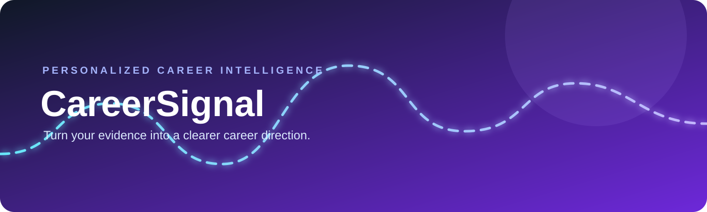
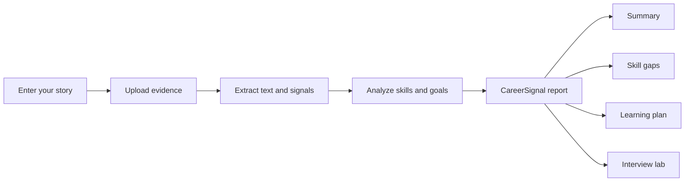

<div align="center">

<a href="https://github.com/THORAN7/career-signal">
  
</a>

# CareerSignal

### Turn your evidence into a clearer career direction.

<p>
  <strong>Local-first career intelligence for students.</strong><br>
  Build a grounded professional profile from your skills, interests, goals, projects, and resume evidence.
</p>

<p>
  <a href="#-quick-start">Quick start</a> ·
  <a href="#-how-it-works">How it works</a> ·
  <a href="#-privacy--responsible-use">Privacy</a> ·
  <a href="CONTRIBUTING.md">Contributing</a>
</p>


</div>

<br>

> **CareerSignal is not a generic resume generator.** It analyzes the evidence you provide, identifies the distance between your current signal and a target role, and turns that distance into an actionable learning and interview plan.

## ✨ What it does

| Input | Output |
| --- | --- |
| Skills and academic interests | A personalized professional summary |
| Career goals and target role | Computed skill-gap signals |
| Projects and achievements | Prioritized learning recommendations |
| Resume or project evidence | Role-aware interview preparation |

### Built for a strong portfolio

- **Evidence-aware** — upload PDF, DOCX, TXT, Markdown, CSV, or JSON files and extract useful signals locally.
- **Grounded writing** — generated copy is based on the profile and evidence you actually provide.
- **Privacy by default** — local storage, loopback binding, ignored runtime data, and no API key required for the default mode.
- **No fictional starter profile** — every runtime profile begins empty and belongs to the user.
- **Clean architecture** — `src/` layout, typed configuration, FastAPI routes, deterministic analysis, and automated checks.
- **Animated experience** — responsive dashboard, processing states, theme toggle, and polished evidence feedback.

## 🎬 Product flow



## 🚀 Quick start

### Windows PowerShell

```powershell
python -m venv .venv
.\.venv\Scripts\Activate.ps1
python -m pip install -e ".[dev]"
python -m uvicorn careersignal.api:app --host 127.0.0.1 --port 8000 --reload
```

Open **http://127.0.0.1:8000**.

If `.venv` is already active, do not recreate it. If port `8000` is busy, use:

```powershell
python -m uvicorn careersignal.api:app --host 127.0.0.1 --port 8010 --reload
```

### macOS/Linux

```bash
python3 -m venv .venv
source .venv/bin/activate
python -m pip install -e ".[dev]"
python -m uvicorn careersignal.api:app --host 127.0.0.1 --port 8000 --reload
```

### Quality commands

GNU Make is supported on macOS, Linux, WSL, and Git Bash:

```bash
make install
make run
make test
make lint
make typecheck
```

On standard Windows PowerShell, use the direct Python commands above.

## 🧠 How it works

1. **Start with your own signal.** Enter profile details or upload evidence.
2. **Analyze locally.** CareerSignal extracts text from supported documents and detects sections, skills, contact signals, word count, and completeness.
3. **Build a report.** Deterministic analysis combines your self-reported skills with evidence-derived signals.
4. **Review and improve.** Use the gaps, learning plan, and interview prompts to strengthen your next application.

The current offline provider requires no credentials. Hosted LLM support is intentionally opt-in and should only be enabled after reviewing the data-sharing implications.

### Resume intelligence signals

Resume analysis preserves the extracted contact signals in the canonical report:

```json
{
  "contact": {
    "email": "student@example.com",
    "phone": "+1 555 0100"
  }
}
```

The browser also handles older or incomplete analysis payloads safely, so a missing
email or phone signal is displayed as an empty state instead of breaking the dashboard.
CareerSignal extracts these signals locally; they are not sent to an external provider
unless hosted generation is explicitly enabled.

## 🗂️ Repository layout

```text
career-signal/
├── src/careersignal/       # FastAPI application package
├── static/                 # Dependency-free frontend
├── tests/                  # Automated tests
├── examples/               # Fictional demo profile
├── docs/                   # Decisions and visual assets
├── data/                   # Ignored local runtime data
├── pyproject.toml          # Packaging and tool configuration
└── Makefile                # Repeatable developer commands
```

## 🔐 Privacy & responsible use

- Runtime profiles and uploaded files stay under ignored `data/` by default.
- The server binds to `127.0.0.1` by default.
- Uploaded files are analyzed for text and career signals; image-only files are not falsely presented as extracted.
- Never use generated wording to claim experience, achievements, skills, or qualifications you do not have.
- CareerSignal provides guidance, not hiring guarantees. Review every generated statement before sharing it.

## 🧪 Development

```bash
python -m pytest -q
python -m ruff check .
python -m ruff format --check .
python -m mypy
```

See [`docs/DECISIONS.md`](docs/DECISIONS.md) for architectural decisions and [`LICENSE`](LICENSE) for licensing terms.

## 🗺️ Roadmap

- [x] Local-first profile and evidence workflow
- [x] PDF, DOCX, TXT, Markdown, CSV, and JSON extraction
- [x] Word-boundary skill detection and upload analysis
- [x] Responsive animated dashboard
- [x] Typed canonical `CareerReport` model
- [x] Role blueprint library and computed skill-gap engine
- [x] Markdown, DOCX, and PDF exports from one report object
- [x] Optional OpenAI-compatible provider with grounded JSON output
- [x] CI matrix for Python 3.11–3.13, Docker build, and accessibility contract tests

## 📦 Export API

The dashboard and every export are generated from the same `CareerReport` object:

```text
GET /api/report/json
GET /api/report/markdown
GET /api/report/docx
GET /api/report/pdf
```

Role blueprints live in `data/roles/` and currently cover software engineering,
data, ML, frontend, product, UX, cybersecurity, and DevOps paths. The default
engine is deterministic and offline. Hosted generation is opt-in through the
provider interface and receives the grounded report context rather than inventing
skills, employers, degrees, or achievements.

## 🐳 Docker

```bash
docker compose up --build
```

The container runs as a non-root user and includes a health check at
`/api/health`.

## 🤝 Contributing

Issues, documentation improvements, UI refinements, and test coverage are welcome. Please read [`CONTRIBUTING.md`](CONTRIBUTING.md) before opening a pull request.

## 📄 License

CareerSignal is released under the [MIT License](LICENSE).

<div align="center">
  <br>
  <sub>Built for students who want their next step to be clearer.</sub>
</div>
